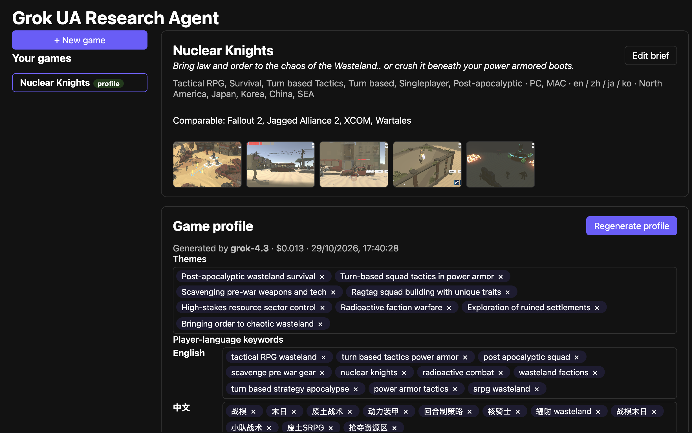
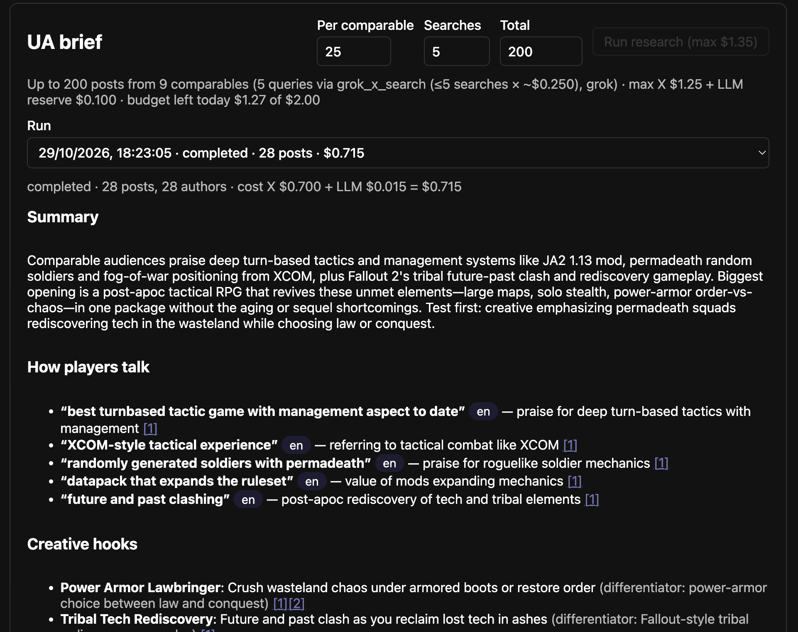
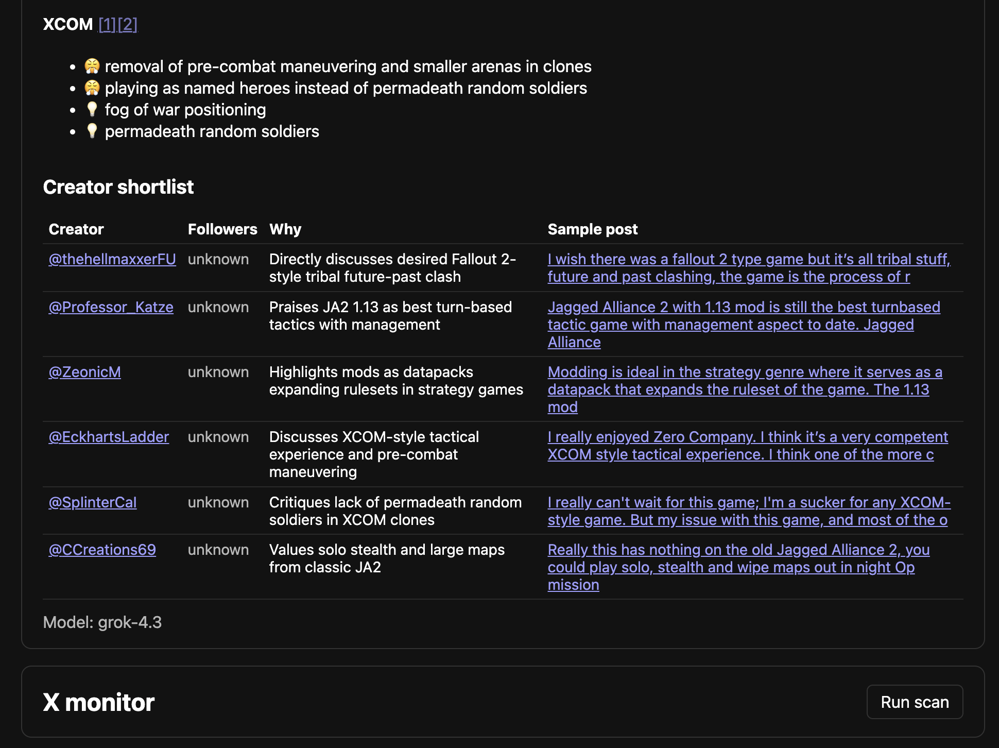

# Grok UA (User Acquisition) Research Agent

Marketing-intelligence tool that uses Grok (xAI API, live X search) to watch X posts about a game launch
across languages (zh, ja, ko, en), classify each post (sentiment, bug report, praise, question, influencer
spike), and surface insights.





```
backend/   FastAPI (uv, Python 3.11)  -> http://localhost:8000  (docs at /docs)
frontend/  Vite + React + TS + TanStack Query -> http://localhost:5173 (proxies /api to :8000)
```

## Setup

```bash
cp .env.example .env        # optional: set XAI_API_KEY to use Grok; empty = FakeProvider sample data
```

### Backend

```bash
cd backend
uv sync
uv run alembic upgrade head   # optional: the server also migrates on startup (DB_AUTO_MIGRATE=true)
uv run uvicorn app.main:app --reload --port 8000
uv run pytest               # tests
uv run ruff check . && uv run ruff format .
```

Layout: `app/models` (domain dataclasses), `app/schemas` (Pydantic API DTOs + explicit mappers),
`app/api/routes`, `app/services`, `app/providers` (`LLMProvider` protocol, `GrokProvider`, `FakeProvider`),
`app/repositories` (`Repository` protocol; `SqlRepository` used by the app, `InMemoryRepository` for tests),
`app/db` (SQLAlchemy Core tables, engine, migration helper), `alembic/` (migrations).

### Data & migrations

- **Where data lives:** `backend/data/app.db` (SQLite) and `backend/data/uploads/` (normalized images). Both are
  gitignored. Delete the folder to reset everything.
- `DATABASE_URL` overrides the location (any SQLAlchemy URL). Migrations run automatically on startup; set
  `DB_AUTO_MIGRATE=false` to manage them yourself with `uv run alembic upgrade head`.
- New migration after changing `app/db/tables.py`: `uv run alembic revision --autogenerate -m "..."`, review, commit.
- Tables: `games`, `images`, `game_profiles`, `scans`, `posts`, `provider_usage` (LLM cost ledger, so the daily budget
  survives restarts).
- **Moving to Supabase/Postgres:** the schema is portable (JSON columns, timezone-aware timestamps, named
  constraints). Add a driver (`uv add psycopg[binary]`), set
  `DATABASE_URL=postgresql+psycopg://…` (Supabase connection string), run `uv run alembic upgrade head`. Images
  would move to Supabase Storage behind `image_service` (not done yet).

### Images

Screenshots (≤5) and key art (≤2) per game, PNG/JPEG/WebP up to 15 MB. The server decodes every upload with Pillow,
applies EXIF rotation, strips metadata, converts WebP→PNG and downscales to 1568 px on the longest side (the size
vision models use anyway). Key art is sent to Grok first during profile generation. Limits are configurable:
`MAX_SCREENSHOTS`, `MAX_KEY_ART`, `MAX_IMAGE_UPLOAD_BYTES`, `MAX_IMAGE_DIMENSION`.

### Frontend

```bash
cd frontend
npm ci
npm run dev                 # http://localhost:5173
npm run build
```

## API (all under `/api/v1`)

| Method | Path | Purpose |
| --- | --- | --- |
| GET | `/health` | Liveness + active provider (`fake` or `grok`) |
| GET / POST | `/games` | List / create games from the "Your game" brief |
| GET / PATCH / DELETE | `/games/{id}` | Read / update / delete a game |
| POST / GET | `/games/{id}/images` | Upload (multipart `file` + `kind`=`screenshot`\|`key_art`) / list (`?kind=`) |
| GET / DELETE | `/games/{id}/images/{image_id}` | Serve image / delete it |
| POST | `/games/{id}/profile/generate` | Generate UA game profile from the brief via the LLM provider |
| GET / PUT | `/games/{id}/profile` | View / save the edited profile |
| POST / GET | `/games/{id}/scans` | Run a scan now / list scans |
| GET | `/scans/{id}` | Scan status |
| GET | `/games/{id}/posts` | Classified posts (`sentiment`, `category`, `language`, `limit` filters) |
| GET | `/games/{id}/insights` | Aggregates: totals, sentiment over time, top issues, spikes |

The brief accepts `description`/`differentiators` up to 5000 chars and `seed_keywords` per language
(e.g. `{"zh": ["战棋", "末日"]}`), which Grok treats as authoritative player phrasing.

## Roadmap

Discord alerts, MCP server, Supabase (Postgres) repository, Vercel deploy, OpenAI model comparison.

## UA research (X → Grok UA brief)

Collects recent X posts about each comparable game (plus your per-language keywords), then has Grok
(grok-4.3, Responses API, no search tools) analyze **only those posts** into a UA brief.

| Endpoint | What it does |
| --- | --- |
| `GET /api/v1/games/{id}/research/estimate?max_posts_per_comparable=&max_posts_total=` | Dry run: worst-case cost (posts × $0.005 + $0.10 LLM reserve), today's budget left, planned queries. Costs nothing. |
| `POST /api/v1/games/{id}/research` | Runs collection + analysis synchronously (can take minutes). Body `{max_posts_per_comparable, max_posts_total}` (clamped to server caps). 201 with the full run; 429 if the worst case would exceed the $2/day budget. |
| `GET /api/v1/games/{id}/research` | Past runs for the game (status, counts, cost). |
| `GET /api/v1/research/{run_id}` | One run: brief (phrasing, hooks, competitor complaints, creators), stats, cost, and the referenced posts with links. |

Queries exclude retweets and deal/sale terms; spam and links-only posts are dropped client-side.
Every X request is recorded in the cost ledger; collection stops when the budget, caps, or an X
error (402 credits / 403 tier / 429 rate limit) is hit. Creator follower counts come from X, never the model.
Without `X_BEARER_TOKEN` a deterministic fake X client is used.

### Research collector (Grok x_search)

`RESEARCH_COLLECTOR=grok_x_search` (default) collects player posts via Grok's built-in `x_search`
tool (xAI Responses API, billed to the xAI balance: ~$5 per 1k posts fetched + tokens; actual cost
from `usage.cost_in_usd_ticks`). Set `RESEARCH_COLLECTOR=x_api` to use the X API v2 client instead.
Knobs: `RESEARCH_MAX_SEARCHES` (8), `RESEARCH_GROK_COST_PER_SEARCH_USD` (0.25, preflight estimate),
`RESEARCH_SEARCH_DAYS` (90), `RESEARCH_GROK_MAX_TOOL_CALLS` (3), `RESEARCH_EXCLUDED_HANDLES` (deal bots).
Posts without a real x.com status URL, outside the window (by snowflake id time) or not among
Grok's citations are dropped. Follower counts from Grok are marked "reported by Grok (unverified)".

### Grok x_search vs. X API: which collector to use

Two ways to get X data into this tool, billed to different accounts:

| | Grok `x_search` (default) | X API v2 (`x_api`) |
|---|---|---|
| Billing | xAI API credits (same balance as Grok) | Separate X developer account, pay-per-use credits |
| Setup | `XAI_API_KEY` only | `X_BEARER_TOKEN` + purchased X credits |
| Post search | Grok picks and filters relevant posts; good semantic relevance, multilingual | Exact query syntax (`lang:`, `-is:retweet`), full control over what is pulled |
| Follower counts / author data | Not reliably returned; marked "reported by Grok (unverified)" | Exact `public_metrics` from X user expansions |
| Best for | Player phrasing, hooks, complaints | Creator/influencer shortlists where reach numbers matter |

Key learning: the xAI credits alone are enough to search X through Grok, but if accurate follower
counts matter (e.g. ranking creators for outreach), use the X API, which returns verified author metrics.
A real first run (Oct 2026) with Grok `x_search` cost $0.71 for 5 searches, 28 usable posts, with zero
hallucinated posts but no follower counts.
